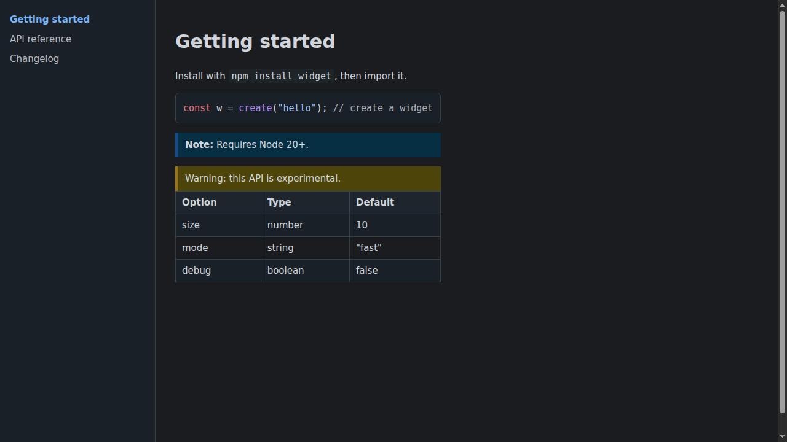

# NightLens — Premium Intelligent Dark Mode

> **Transform every website into a comfortable dark interface while preserving its original design, readability, and brand identity.**

NightLens is a production-ready, privacy-first Chrome extension that intelligently remaps light websites into meticulously crafted dark themes — never inverting blindly, always guaranteeing readability.

Built with **TypeScript · React 19 · Vite · Chrome Manifest V3** — strict, minimal, and auditable.

---

## ✨ Premium Experience

### 🎨 10 Crafted Themes
- **Midnight** — Deep blue-black, balanced
- **Deep Space** — Rich indigo
- **AMOLED** — Pure black, battery-saving
- **Soft Dark** — Warm charcoal, gentle on eyes
- **Charcoal** — Neutral professional gray
- **Graphite** — Cool medium-dark
- **Solarized** — Scientific precision
- **Nord** — Arctic frosted blues
- **Dracula** — Vibrant twilight purple
- **OLED Night** — True black with crisp highlights
- Plus **Custom** — create, save, export, import your own with color pickers.

Instant preview, per-website theme assignment, and live switching.

### 🎛️ Complete Personalization
- **Brightness** · **Contrast** · **Warmth** · **Saturation** · **Text Size** · **Accent Hue**
- Live preview, meaningful effect, instantly persisted.
- Preset chips: Default, Soft, Vivid, Warm Night, Cool, Dim.

### 🌐 Intelligent Website Management
- Exact-hostname matching (`example.com` ≠ `www.example.com`, no inheritance).
- **Whitelist / Blacklist** with per-site exclude / force-on.
- Per-domain theme, per-domain overrides (brightness/contrast/warmth).
- Compatibility profiles: **Auto · Gentle · Aggressive · Media-Only**.
- Custom CSS per domain (validated, no `@import`/`javascript:`).

### ⏰ Automation
- **Schedule:** Enable dark mode during selected hours (e.g., 22:00–07:00, overnight supported).
- **System Integration:** Follow `prefers-color-scheme`, respond to OS changes, manual override.
- **Per-site memory:** Remembers and restores every domain’s preferences.

### 📖 Smart Reading Mode
Distraction-free typography: adjustable font size, line height, max width (600–900px), font family (System/Serif/Sans/Dyslexic). Hides navigation/ads visually.

### ♿ Accessibility — Core, Not Afterthought
- **WCAG AA (4.5:1) and AAA (7:1) contrast guarantees** — enforced per-element via `ensureContrast`.
- High-contrast toggle, link underlining, reduced-motion support.
- Color-blind-friendly palettes (protanopia/deuteranopia/tritanopia aware via accent hues).
- Keyboard-navigable, visible focus rings, screen-reader labels, `role=switch`.

### ⚡ Performance — Lightweight by Design
- One forced style recalc per batch (strip → read → write).
- Set-deduplicated queue, WeakSet processed tracking, 400 elements/frame (tunable).
- MutationObserver filtered to color-relevant changes only; no feedback loops.
- Shadow DOM per-root contexts, SPA navigation detection (history patch + popstate/hashchange).
- Duplicate rule prevention (max 5000, then reset).

### 🔒 Privacy-First — Local Only
- **Only `storage` + `alarms` permissions.** No `tabs`, `history`, `cookies`, `webRequest`.
- Settings stay in `chrome.storage.local` (`nightlens:settings`), never leave device.
- No fetch/XHR/WebSocket/eval/innerHTML — grep-verified.
- No analytics, telemetry, or remote config.
- See [Security & Privacy](docs/SECURITY_AND_PRIVACY.md).

### 🧩 Advanced Features
- **Theme import/export** (portable JSON)
- **Backup/restore** (export all settings)
- **Quick toggle** — `Alt+Shift+D` (rebindable at `chrome://extensions/shortcuts`)
- **Per-website theme profiles**
- **Dynamic native-dark detection** — leaves already-dark sites alone (force-on override)
- **Developer Mode** — `data-nl-dev` annotations + console stats
- **Reset controls** — confirmed, restores defaults and clears site rules

---

## 🚀 Quick Start

**Requirements:** Node ≥ 22.12 (tested on 22.22.2), Chrome/Chromium.

```bash
npm install
npm run build          # → dist/
# Chrome: chrome://extensions → Developer mode → Load unpacked → select dist/
```

**Windows users:** See [Windows Setup](docs/INSTALL.md#windows).

| Command | Purpose |
|---|---|
| `npm run build` | Production build to `dist/` |
| `npm run typecheck` | `tsc --noEmit` strict |
| `npm test` | 573 unit tests (Vitest + jsdom) |
| `npm run test:e2e` | 40+ E2E in real Chromium with extension loaded (Playwright) |
| `npm run verify` | typecheck + test + test:e2e |

E2E Chromium from `$NIGHTLENS_CHROMIUM` (default `/opt/pw-browsers/chromium-1194/chrome-linux/chrome`).

---

## 🎯 Design Philosophy

**Engine first, then product.** The color engine is the heart — intelligently detecting backgrounds, text, borders, links, buttons, form controls, gradients, shadows; mapping them through theme tokens while preserving hue and enforcing contrast against *effective* backgrounds (alpha-blended ancestors). **No blind inversion**, no destroyed brand identity.

Premium UI inspired by **Linear, Raycast, Arc, Vercel, Notion, Apple** — minimal, elegant, consistent.

---

## 📸 Screenshots

| Popup | Settings Dashboard | Theme Selection |
|---|---|---|
|  |  |  |

Additional fixtures: News, Docs, Edu, Shop, Search, WebApp, Modern, CodeHost — see `docs/screenshots/`.

---

## 🏗️ Architecture

```
            chrome.storage.local  ("nightlens:settings")
                 ▲        │ onChanged
   writes        │        ▼
 ┌──────────┐    │   ┌──────────────────────────────┐   status push / get-status
 │ Popup /  │────┘   │ Content script (every frame) │──────────────────────────────► Popup
 │ Options  │        │  decide() → ThemeEngine      │◄──── tabs.sendMessage(frameId:0)
 └──────────┘        └──────────────────────────────┘
 ┌──────────────────────┐
 │ Service worker       │  Alt+Shift+D toggles enabled; badge OFF; schedule alarm
 └──────────────────────┘
```

Full details: [Architecture](docs/ARCHITECTURE.md) · [Feature Matrix](docs/FEATURE_TEST_MATRIX.md)

---

## 🔐 Permissions

| Permission | Why | Not requested |
|---|---|---|
| `storage` | Save settings locally | `tabs`, `history`, `cookies`, `webRequest`, host_permissions |
| `alarms` | Check schedule every minute | — |
| `content_scripts` on `http/https` | Theme must run on every site | `file://`, `chrome://`, PDF viewer |
| `Alt+Shift+D` | Keyboard toggle | — |

No `web_accessible_resources`, no `externally_connectable`, no remote scripts. Default MV3 CSP kept.

---

## 📚 Documentation

- [Install & Build (Windows included)](docs/INSTALL.md)
- [Architecture](docs/ARCHITECTURE.md)
- [Security & Privacy](docs/SECURITY_AND_PRIVACY.md)
- [Known Limitations](docs/LIMITATIONS.md)
- [Troubleshooting](docs/TROUBLESHOOTING.md)
- [Feature ↔ Test Matrix](docs/FEATURE_TEST_MATRIX.md)
- [Browser Test Checklist](docs/BROWSER_TEST_CHECKLIST.md)

---

## 🧪 Testing

- **Unit:** Color parsing (hex/rgb/hsl/oklch/lab/display-p3), WCAG contrast, palette tokens for all themes × slider extremes, hostname rules, sanitization, decide(), engine quiescence, style generation, UI contrast.
- **Integration:** Popup interactions, persistence, theme switching, exclusions, dynamic DOM.
- **E2E:** Extension load, enable/disable, theme switching, shortcuts, per-site rules, SPA navigation, modern color syntax, special content (img/canvas/svg), native-dark detection, CSP.

Run: `npm test` · `npm run test:e2e` · `npm run verify`

---

## 🗺️ Roadmap

- Hover/active state preservation via pseudo-class remapping
- Logo inversion heuristics (sampling same-origin pixels)
- Early-paint cache (per-origin enabled flag)
- Firefox/Edge builds after MV3 verification
- Visual regression + axe-core audits

See [Limitations & Future Work](docs/LIMITATIONS.md).

---

## 🤝 Contributing

Issues and PRs welcome. Keep the engine reliable, the UI elegant, and the privacy promise.

---

*Crafted with care — privacy-first, performance-obsessed, genuinely excellent dark mode.*
