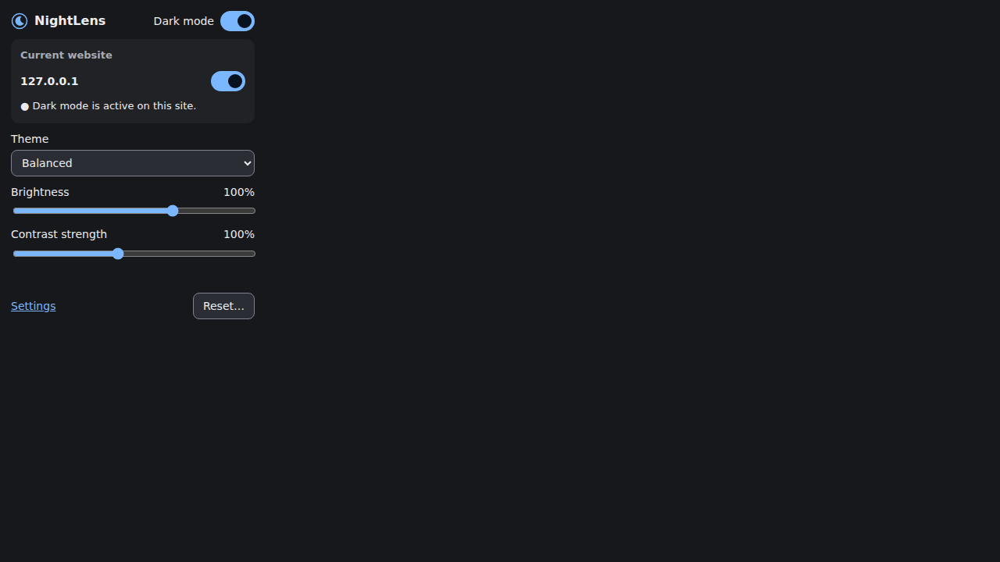
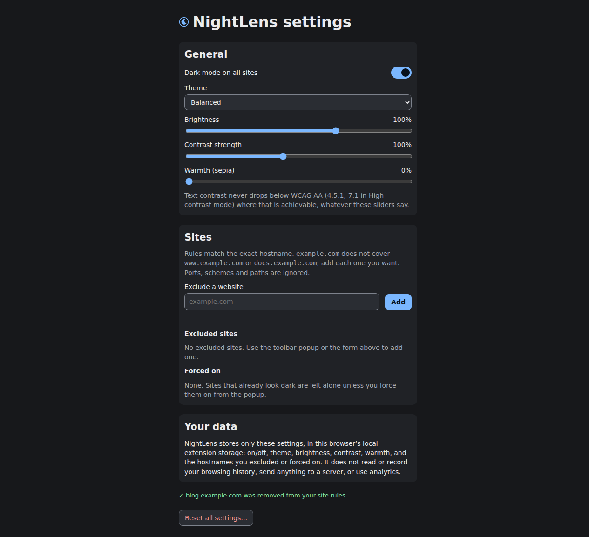

# NightLens

**Intelligent, customizable dark mode for Chromium — locally processed and privacy-first.**

NightLens is a Manifest V3 browser extension that remaps light page colors to readable dark palettes. It uses computed styles and contrast-aware color mapping rather than blindly inverting the page. Photographs, videos, canvases, and large illustrations receive special handling.

Built with **TypeScript, React, Vite, Vitest, and Playwright**.

## Features

### Contrast-aware dark engine

- Detects light and native-dark pages.
- Maps backgrounds, text, links, borders, and small SVG icons through theme tokens.
- Remaps literal CSS gradient stops and shadow colors while preserving geometry.
- Resolves alpha-blended ancestor backgrounds and enforces configured text-contrast targets where the engine can determine the backdrop.
- Leaves non-gradient background images and their descendant colors unchanged to avoid unreadable overlays.

### Themes and visual controls

Ten curated palettes — **Midnight, Deep Space, AMOLED, Soft Dark, Charcoal, Graphite, Solarized, Nord, Dracula, and OLED Night** — plus legacy palettes, system-following mode, and custom themes.

Adjust **brightness, contrast, warmth, saturation, accent hue, and text size**. Changes are stored locally and update open pages. Brightness affects webpage rendering only; it does not change hardware display brightness. **Midnight** is the fresh-install default.

Five **purpose presets** apply a palette together with the calibration that suits a situation: *Balanced dark* (everyday), *Deep dark* (dim rooms, OLED), *Dim reading* (long-form at night), *High contrast* (7:1 text floor, emphasised borders) and *Soft night* (warm, low glare). They are applied in one step and remembered across restarts.

A **live preview** in Settings renders the exact surface set the content script will apply — page, raised card, body text, muted text, link, button, input and border — together with the measured contrast ratios. It is preview-only: nothing on your websites changes until you change a setting.

Custom themes can be created, edited, imported, and exported. Full settings backup/restore is also available.

### Website controls

- Global on/off switch and per-site exclude/force-on rules.
- A rule for `example.com` covers `docs.example.com`; the closest hostname wins.
- Per-site themes, visual overrides (theme, brightness, contrast, warmth), compatibility profiles, and sanitized custom CSS inherit the same way. Overrides are created from the **Websites** tab and only store values that differ from your global settings.
- IP addresses and single-label hostnames match exactly; suffix lookalikes such as `notexample.com` never match `example.com`.
- Reset website preferences without resetting global appearance.

### Dynamic pages and media protection

- Batched `MutationObserver` processing for inserted content, inline style changes, and open shadow roots.
- SPA history/hash navigation handling and late-stylesheet reprocessing.
- Deduplicated queues, bounded traversal, parsed-color caching, and configurable batch/debounce settings.
- Images, videos, audio, picture sources, iframes, objects, and embeds are not recolored.
- Large canvases and text-bearing SVG charts retain an appropriate original backdrop; large illustrations are not repainted.
- The explicit **Media only** compatibility profile dims images/videos without recoloring page surfaces. Normal themes do not filter media.

### Accessibility and controls

- Keyboard-navigable popup/options UI with semantic controls, accessible names, live status messages, visible focus, arrow-key section navigation, and a skip link to the settings content.
- High-contrast mode, link underlining, and reduced-motion support (including the OS preference).
- **`Alt+Shift+D`** toggles NightLens globally. Rebind it at `chrome://extensions/shortcuts` where supported.
- Optional schedules, system appearance integration, reading mode, and local developer diagnostics.

### Privacy

Settings stay in `chrome.storage.local` under `nightlens:settings`. NightLens has no analytics, tracking, remote configuration, or browsing-history collection. Computed page colors remain in memory.

The only requested extension permission is **`storage`**. HTTP/HTTPS content-script access is required to restyle pages. No `tabs`, `history`, `cookies`, `webRequest`, host permissions, remote scripts, or externally connectable messaging are requested. See [Security & Privacy](docs/SECURITY_AND_PRIVACY.md).

## Install for development

Requirements: **Node.js 22.12+** and a Chromium-based browser.

```bash
npm ci
npm run build
```

1. Open `chrome://extensions`.
2. Enable **Developer mode**.
3. Choose **Load unpacked** and select the repository's `dist/` directory.
4. Reload existing tabs after installing or updating the extension.

For Windows details and troubleshooting, see [Installation](docs/INSTALL.md).

## Use NightLens

1. Open the toolbar popup to toggle dark mode globally or exclude the current site.
2. Choose a theme and adjust brightness/contrast. Expand **More** for warmth and shortcut information.
3. Open **Settings** for custom themes, per-site configuration, accessibility, scheduling, reading mode, performance, import/export, and resets.
4. On a native-dark site, choose **Force dark mode on this site** only if you want NightLens to restyle it anyway.

Browser-internal pages, the Chrome Web Store, local files, and PDF viewers are unsupported.

## Screenshots

| Popup | Settings |
|---|---|
|  |  |

Additional fixture screenshots are in [`docs/screenshots/`](docs/screenshots/). These are project fixtures, not a claim of compatibility with every live website.

## Verification

| Check | Result in this repository |
|---|---|
| `npm run typecheck` | Pass — strict TypeScript, no errors |
| `npm test` | Pass — 704 Vitest tests across 15 files (engine, colour, storage, UI, accessibility, security, privacy invariants) |
| `npm run build` | Pass — Manifest V3 bundle in `dist/` |
| `npm run test:e2e` | Pass in CI — 42 Playwright tests in real Chromium with the extension loaded, [run 42561937603](https://github.com/ujjwalmaurya890-ops/night-lens/actions/runs/42561937603) |

Claims in this README are limited to what those checks demonstrate. Per-site behaviour on live
websites is heuristic; see [Known limitations](docs/LIMITATIONS.md).

## Commands

| Command | Purpose |
|---|---|
| `npm run typecheck` | Strict TypeScript checking |
| `npm test` | Vitest unit/integration tests in jsdom |
| `npm run build` | Production extension in `dist/` |
| `npx playwright install chromium` | Install the browser used by E2E tests |
| `npm run test:e2e` | Build and test the real extension in Chromium |
| `npm run verify` | Type-check, unit tests, and E2E tests |

Set `NIGHTLENS_CHROMIUM=/path/to/chrome` to use a particular executable. E2E tests require a Chromium version that supports Manifest V3 extension loading. Actual results and unverified checks are recorded in [Test report](docs/TEST_REPORT.md) and [Limitations](docs/LIMITATIONS.md).

## Architecture

```text
Popup / Options ── writes ──> chrome.storage.local
                                  │ onChanged
                                  ▼
HTTP/HTTPS content script ──> decision + ThemeEngine
        │                             │
        │                             ├─ computed-color mapper
        │                             ├─ generated attribute rules
        │                             └─ batched mutation/SPA handling
        ▼
Validated status messages ──> Popup

MV3 service worker: Alt+Shift+D, install/startup badge, validated messages
```

Source is organized into `src/engine/`, `src/content/`, `src/background/`, `src/shared/`, `src/popup/`, `src/options/`, and `src/ui/`. See [Architecture](docs/ARCHITECTURE.md).

## Contributing

Read [CONTRIBUTING.md](CONTRIBUTING.md) and the [development guide](docs/DEVELOPMENT.md), use the issue templates, and include test evidence in pull requests. Keep changes focused and preserve the privacy and permission guarantees — `tests/unit/privacy.test.ts` fails the build if network access, extra permissions, tracking dependencies, or HTML/eval injection appear.

NightLens is available under the [MIT License](LICENSE).

## Documentation

- [Architecture](docs/ARCHITECTURE.md) — runtime model, module map, theming pass
- [Development guide](docs/DEVELOPMENT.md) — setup, commands, adding themes/messages, testing rules
- [Installation](docs/INSTALL.md)
- [Privacy](docs/PRIVACY.md) — what is stored, what is processed, why each permission exists
- [Security policy](SECURITY.md) · [Security & privacy details](docs/SECURITY_AND_PRIVACY.md)
- [Known limitations](docs/LIMITATIONS.md)
- [Changelog](CHANGELOG.md)
- [Engineering audit](docs/ENGINEERING_AUDIT.md) · [Contribution tracker](docs/CONTRIBUTION_TRACKER.md) · [Engineering report](docs/FINAL_ENGINEERING_REPORT.md)
- [Browser test checklist](docs/BROWSER_TEST_CHECKLIST.md)
- [Feature/test matrix](docs/FEATURE_TEST_MATRIX.md)
- [Test report](docs/TEST_REPORT.md) · [Implementation report](docs/IMPLEMENTATION_REPORT.md)
- [Troubleshooting](docs/TROUBLESHOOTING.md)
